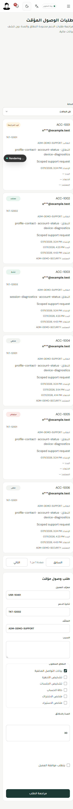
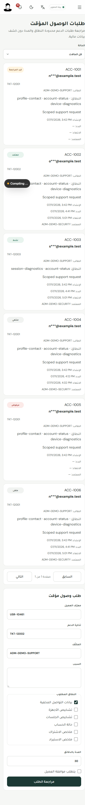

# Temporary support access and CI repair

Date: 7 November 2026. Evidence is separated by execution boundary. Hosted activation is not approved for this candidate. The user's earlier dashboard/logo approval does not authorize this API/schema candidate.

## Implemented behavior

The Admin access module now uses the existing canonical `/api/v1/admin/support-access/requests` API in live mode. Fixture routes remain confined to mock mode. Real UUIDs, canonical ticket references, cursor pagination, request versions and exact resource/action pairs are preserved. Unknown totals, historical review metadata and unsupported projections remain unknown; no customer identity, audit receipt, timeline, date or successful provider result is synthesized.

Creation maps the existing form to purpose, read-only resource scopes and duration. Review carries the operator's displayed version; it never silently substitutes a refreshed version after a conflict. Automatic idempotency survives an uncertain response. Approvals display the exact actions, require independent review and wait for customer consent when required. Denial remains available to an independent authorized reviewer.

The API adds actual request review metadata without replacing old response fields or immutable stored idempotency receipts. The workspace endpoint adds only the context needed to use/end its exact authorized grant. The client does not require the broader request-read permission. The server rechecks the existing authorized workspace RPC and selected grant under request/grant locks; active-owner, consent, assignee, window and revocation guards remain enforced. Strict browser parsing rejects unexpected/raw fields and projections outside the approved actions. Expiry and authorization/contract loss clear protected query data and local inputs.

Review uncovered two existing authorization defects now repaired: `/me/support-access/requests` explicitly filters the authenticated owner, including dual-role customers; `/end` checks the locked request's assignee while administrative revoke retains its separate permission. A narrow new migration permits a genuine denial before customer consent. It does not manufacture consent or permit an approved consent-required request without it. No historical migration, role assignment or permission grant was changed.

## Capability matrix

| Page/action | Authority | Client / API | Source/result | Evidence / limit |
| --- | --- | --- | --- | --- |
| List/detail | `support.access.read` | live access adapter → canonical GET | RLS request rows, actual latest visible grant, cursor | Client contract tests; local SQL; hosted GET/list of the created test request |
| Create | `support.access.request` | canonical POST | Persisted pending request, immutable operation receipt, notification enqueue | Real candidate adapter in the authenticated browser created one self-owned status-only request; provider delivery is not claimed |
| Customer consent | Current customer + recent authentication | `/me/.../decision` | Owner/version fence, actual consent | Local SQL success; hosted existing session returned `403 RECENT_AUTH_REQUIRED` |
| Approve/deny | `support.access.approve`, recent authentication, separate reviewer | canonical decision POST | Version, exact narrowed scope, consent and timed grant | Local real SQL; adapter replay/version tests. A successful hosted multi-actor grant is still pending |
| Workspace | `support.access.use`, assigned active grant | workspace GET only | Existing protected projection RPC + minimal same-grant context | Use-only local SQL; strict client projection tests; hosted pending request correctly returned 403 |
| End | `support.access.use`, actual assignee | `/end` + displayed version | Grant revocation and actual request receipt | Wrong-assignee SQL leaves state, grant and receipt count unchanged; assigned end succeeds locally |
| Administrative revoke | `support.access.revoke`, recent authentication | `/revoke` + displayed version | Existing independent revoke semantics | Local real SQL and adapter tests; no hosted grant was created/revoked |

## Hosted evidence

Target: `https://staging.masarifiratibi.com/admin`; API: `https://api.staging.masarifiratibi.com`. Existing authentication was preserved. The candidate adapter was bundled from the working source and executed in browser memory against the actual API, with mocks disabled. This did not replace the hosted dashboard or API.

One request targeted the current operator's own customer profile, using only `account-status/read-status`, five minutes, and required customer consent. Its creation succeeded; independent detail/list reads confirmed persisted pending state and version 1. The synthetic ticket reference was a qualification marker, not a claim of an existing support case. The record was retained; no manual deletion or uncertain write retry was performed. No financial data was read and no grant was created. A pending notification is not evidence of provider delivery.

The existing API omits the new review metadata. The client preserved these fields as null. The pending workspace was denied with 403. The client rejected requester self-review. Direct customer-consent and reviewer probes both returned `403 RECENT_AUTH_REQUIRED`; that guard was retained. Hosted success through a separate reviewer and fresh private authentication remains an acceptance gate after an approved compatible rollout.

Public staging API `/health/live` returned 200 with version `a488f4adbf8f291ea49b09940baf5cdb4fe5f0e7`, started `2026-11-01T22:02:15.674Z`. The existing Nginx configuration explicitly blocks public `/health/ready` with 404; that result does not test the private application's readiness. The concurrent primary API release 134 receipt is a different service baseline and must not be substituted. Private browser screenshots and raw test/CI receipts remain in ignored evidence directories.

## CI repair rationale

- Migration provenance: register three previously published missing migration hashes; preserve all 183 earlier hashes and historical SQL. Refresh exact reviewed database inventory. The new consent-denial migration is a separate fourth addition, with no new tables/functions.
- Voice fixtures: return the real financial-generation binding in test doubles; preserve rejection of missing/malformed generation. Inject the profile-freeze race before generation binding acquires the profile lock, avoiding a test-created deadlock without weakening production fences.
- Private reader: pin reviewed application schema 17 and prove versions 1–16 unchanged. Reader support remains 16; actual schema 17, future 18 and unknown sources remain indeterminate/rejected. The corpus remains 69 cases, including 27 indeterminate cases.
- Secret history scan: classify only independently verified exact immutable historical public values/checksums. Retain raw redacted Gitleaks findings and a separate classification sidecar. Unknown/changed/copied findings fail closed. No broad rule/path exclusion or history rewrite was added.
- Mobile/API quality: preserve exact shadow colors through a semantic token; reuse translated accessibility copy; narrow the optional-native-facade boundary exception to its exact re-export; retain executable negative controls. Other API changes in this group are formatting or an explicit missing-fixture guard.

## Verification boundaries

Focused local receipts include 249 Voice SQL cases, 47 Security unit cases, 26 real Security SQL cases, schema/provenance/portable-reader checks, and the mobile quality chain. The consent-denial CHECK was tested incrementally against the owned disposable database; clean replay of all 187 migrations must be confirmed by CI. Docker and all owned database services were stopped with volumes preserved.

Final complete Admin checks, browser screenshots, exact-source Linux artifacts and CI run results are recorded in the release packet once available. A passing fixture or local SQL result does not establish deployed multi-actor authentication, worker/provider delivery, physical mobile acceptance or overall production readiness.

## Reflow and additional CI findings

The actual local Playwright screenshot review found that desktop flex bases became heights after the toolbar/footer switched to columns. At390 pixels the title block was420 pixels high, the duration group150 pixels, and its input about83 pixels. Scoped column overrides now use automatic flex bases: title89.4 pixels and input44 pixels. The complete20 list combinations (Arabic/English × light/dark ×1440/1280/1024/768/390) have no document overflow; detail/workspace were also inspected at1440 and390 in both locales/themes. These are synthetic local UI screenshots, separate from the real hosted API receipts. Before/after mobile examples are attached below. Static scope/projection labels and fixture policy/timeline copy now follow the chosen locale without translating customer-entered content.

The published `ccc7e401` qualification passed all1045 Admin tests locally and the CI Admin job, secret classification, private Voice journal preparation, and four responsive browser projects at the time of follow-up. Its Linux Admin runtime build also succeeded. That artifact is superseded by the subsequent reflow repair and must not be activated.

The same full CI run exposed additional stale fixtures: the erasure fake did not accept the production driver's bounded QueryConfig; the Voice policy spec still excluded an administrator's own financial account after the reviewed personal-finance policy changed; the obligation identity test omitted the real generation gate's reset HTTP/SQLite boundary; and the historical110→111 upgrade test called today's repository functions introduced only in migration186. Repairs retain timeout/rollback/order assertions, cross-owner/suspended denial, leases/Posting-off/unchanged ledger, and owner-generation headers. The upgrade fixture loads its exact introducing commit's repository and tests its actual owner/idempotency/quota/capture/claim calls; production reset fences and historical SQL remain unchanged. The fresh exact-source CI run is the authority for the complete updated suites and cold database replay.

## Actual serving baseline readmission

The existing human Chrome root console was inspected with read-only commands. The public API default upstream is3001, supplied by `masarifi-assistant-reports-api-ledger-scope-20261023-t04-r18-8937ba09`; the similarly named legacy staging container on3000 is not that upstream. The dashboard remains the accepted97ad2551 container on3041. The primary API134 is separate and protected. Current Nginx content hash still matches the earlier accepted routing checkpoint. The actual database constraint was queried using an explicit read-only session and five-second statement timeout; it still permits pending but not denied-without-consent. No schema/configuration/service/firewall mutation was performed.

A candidate package must preserve all existing instances and specialized routes. The intended activation boundary is two support-access API prefixes and the Admin frontend, with new loopback candidates and pinned routing rollback. The existing default API, primary API, workers, financial/provider routes and mobile sessions remain protected. Exact current identities/fingerprints, free candidate ports, artifacts and qualification receipts are bound in the release packet; a stale checkpoint must be readmitted before execution.

## Exact-source follow-up qualification

On73b790d, both Staging Client real SQL runs passed; Private Journal synthetic, Linux encrypted SQLCipher/JNI and disposable Android lanes all passed. The API unit suite passed206 suites/2240 tests; mobile passed. All187 canonical migrations and the historical Tracking/local-main upgrades passed before the upgraded-database integration run exposed one stale planning-worker expectation.

The final CI-only repair keeps the generation fence's earlier `FINANCIAL_GENERATION_STALE` rejection and verifies that an obsolete worker leaves the reclaimed lease/status/attempt intact; stale completion remains rejected by its original planning fence. Security controller tests retain their exact46-operation partition and explicitly verify the separate financial-reset controller and58 composed operations. The secret scanner classifies one exact historical synthetic fake lease in addition to the11 earlier known noncredentials; real unknown/copied/mutated findings remain blocked. Android identity validation keeps the original registered package/project identities and binds only the already published Arabic display name and paused iOS ad-hoc profile to their immutable reviewed ancestor commits. No app/EAS/iOS file, credential, permission, signing or physical installation was changed by these repairs.

The full updated qualification and scanned API runtime archive remain pending their fresh exact-commit run. The Linux Admin artifact for73b790d is already built and locally hash-verified; it may be reused only while the complete Admin source tree and runtime/public binding pins remain identical. No hosted activation has been performed.

## Completed 0ffccbd6 run and remaining CI repairs

[Foundation42382098669](https://github.com/masarifiratibi-spec/masarifi.ratibi_app/actions/runs/42382098669) completed with API application, Mobile, Admin, secrets, sentinel redaction and all five Admin browser projects passing. The upgraded SQL integration suite passed151 suites/1066 tests, including the repaired planning fence and real financial-reset journeys. Both Staging Client runs and the complete Private Journal run also passed. Two later gates failed: fresh database static lint and compiled Android display-label verification. Image/container/Trivy/archive qualification was correctly skipped; no scanned API runtime artifact from this run is admitted.

The diagnostic Android build itself completed successfully. Its actual downloaded badging passes the replacement validator against the immutable reviewed display name and registered package. The validator rejects the old name, package suffix changes, duplicated/missing default declarations and embedded/prefixed lookalikes. The source identity guard additionally recognizes the exact already-reviewed iOS production marker only when its introducing commit5482885f is an ancestor; the Android lineage retains its previous exact profile. The two identity files match the peer's45fcaac5 patch; no app/EAS/iOS configuration changed. Local identity/badging tests passed31/31; an independent review passed11 probes using the actual compiled badging. The old CI shell exited at its stale English-label assertion, so post-assertion binary ABI/hash/source receipts were not produced. The unchanged four-ABI verification and receipt steps must pass in replacement CI; successful CMake tasks alone are not the missing artifact proof.

Full streaming Admin admission verified576 shipped tracked source files,52,750 members,44 internal symlinks, toolchain/lock/build/manifest pins and73 static assets. Build `mT4teHZyRNxcKzft789xW` comes from73b790d; its entire Admin tree and both reports sources match0ffccbd6. Runtime SHA256 is `8fe6f57f5bcee817639f0ae3a3102c21aa8b2f25bdadbab587986cf74ab32e88`. This validates artifact identity and structure, not a reproducible rebuild or hosted authentication. The release review packet records remaining gates explicitly and does not authorize activation.

The read-only Supabase catalog matched the actual API database and confirmed177 historical ledger rows, latest version20261107140000, with the original pending-only support consent CHECK. No migration or ledger repair was performed. A blanket187-file replay is outside this release. The human console subsequently expired; fresh routing-context readmission is pending. No SSH/firewall rule, container, service, database row or proxy setting was changed during this packet preparation.

The checker-only repair preserves the original Supabase2.116 mass-check and error policy for public/private/audit. Only the exact source/OID/signature and known line105 inference diagnostic enter a second check with constant tracing disabled. It also requires59 plain, nonexecuting EXPLAIN plans covering all35 dynamic INSERT and24 DELETE variants. Unexpected diagnostics, overloads, source changes or failed plans remain blocking; the entire session rolls back. All21 bounded Node controls passed. Actual PostgreSQL extension qualification awaits replacement CI; the existing native database lacks plpgsql_check and Docker was not restarted because of limited RAM. No production SQL function, migration or checksum changed. The original [CLI SQL](https://github.com/supabase/cli/blob/v2.116.0/apps/cli/src/legacy/commands/db/lint/lint.lint-sql.ts), [CLI JSON contract](https://github.com/supabase/cli/blob/v2.116.0/apps/cli/src/legacy/commands/db/lint/lint.format.ts), and documented [checker arguments](https://github.com/okbob/plpgsql_check#arguments) are the implementation references.

## Continuation on 7 November: exact 1440 CI and serving readmission

[Foundation 42387010902](https://github.com/masarifiratibi-spec/masarifi.ratibi_app/actions/runs/42387010902) finished. PR head 1440f3260ebaa1185527dd7d61c8fe1b7fc9e1e3 is the second parent of executed merge 6ee5f47b78b6d094a9e9486f8af5e5e7b7385d30; both trees are 83aab465f066cde2427aaef92ae025282cdaf99a. API, mobile, Admin, secrets, sentinel redaction, five browser viewports, and Android succeeded. Diagnostic artifact 13580402640 (11,712,680 bytes; ZIP SHA256 133a7b6fe1c796bd88d7a8e368462cfb98ff936a91e0f1a99a9aebd01384710f) was independently downloaded. Its source receipt matched the merge SHA, the compiled name/package validator passed, and the SHA256 receipt contains the compiled resources and distinct libappmodules.so for arm64-v8a, armeabi-v7a, x86 and x86_64. This is CI diagnostic evidence, not a device installation. Staging 42387010938 and 42387004235 and Private Journal 42387010921 all passed.

All upgraded integration tests passed; the disposable reset applied 187 migrations. The fresh real lint session reached standalone EXPLAIN but the CI login lacked privileges on financial_reset_resources. No scanned API archive was produced. The checker now verifies the catalog owner, SECURITY DEFINER flag and exact configuration before switching to the actual function owner/search path for the 59 nonexecuting plans. Any SET-only disposable bootstrap membership is transactional and rolls back; ambiguous existing membership is rejected. The initial repair and path hardening have 23 passing Node controls. Replacement CI, not these unit cases, must qualify the real extension and subsequent jobs.

A renewed Hostinger console, inspected without SSH, found an additional immutable Nginx include: the prior admin support path inherits /api/v1/admin/ on 3033, not the default 3001. A checker restricted to flat SSL snippets stopped with UNSUPPORTED_SERVER_INCLUDE. The revised read-only tool admits only that exact snippet digest and the three observed heads, checks every other neighbor and clones the effective 3033 or 3001 body per family. The four new locations retain scoped headers and honor HTTP/server/location timeout inheritance. Main config, master process, resource headroom, running ID set and empty candidate ports were observed, without installation or reload. Fresh candidate and context hashes from the revised tool are still required.

A five-second read-only catalog session confirmed PostgreSQL 17.6, old validated consent constraint, 177 versions, latest 20261107140000 and the version-list digest. The SQL renderer binds the cluster fingerprint, ledger, original/target CHECK and canonical SQL bytes in one locked transaction. A separate PostgreSQL 18 disposable fixture, using a non-superuser ledger executor with no inherited owner rights, rejected wrong database/history, rolled back a forced postimage failure, committed exactly one canonical migration and rejected replay and consent-free approval. Temporary owner membership did not survive. The hosted database was not modified.

All 106 inventory entries still correspond to the 106 page files. The three access entries now name the canonical live adapter rather than quoting its mock fallback, and two truncated endpoint examples are corrected. In a new anonymous Playwright context, Admin returned 307 to the accounts origin, both support-access API families returned 401, the prior Admin static hash matched and public default /health/live remained a488f4ad. The 390px screenshot shows the accounts provider's human verification challenge, not an authenticated form or candidate grant. No challenge was submitted. Existing authenticated self-owned pending receipts remain separate; full hosted grant/revoke acceptance is outstanding.
